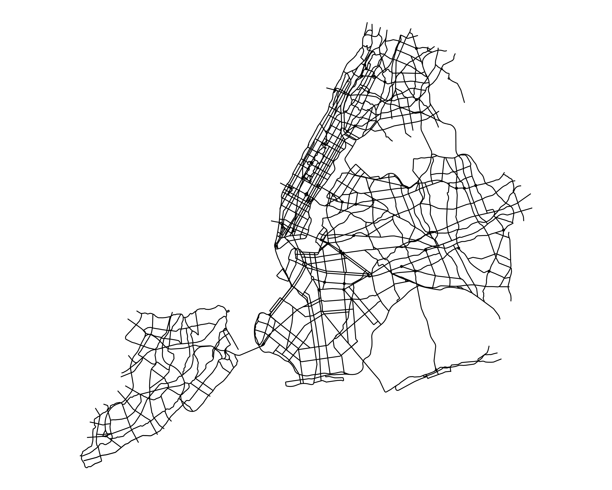
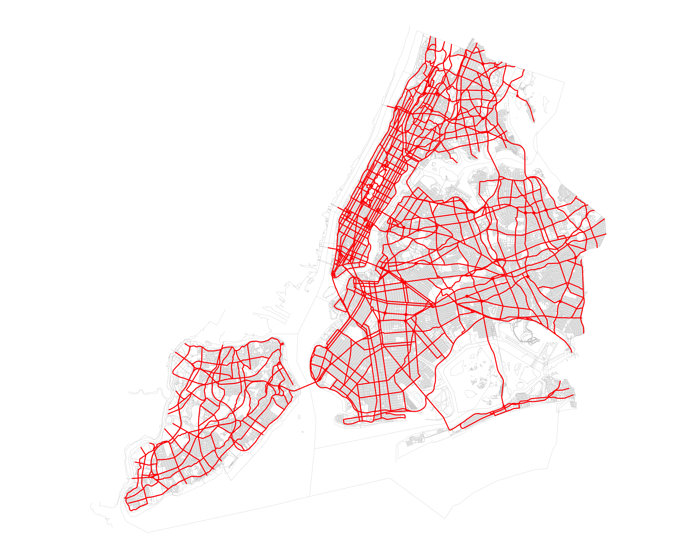
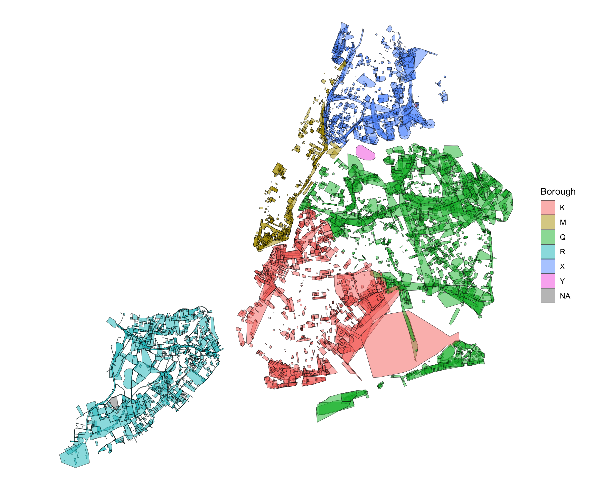
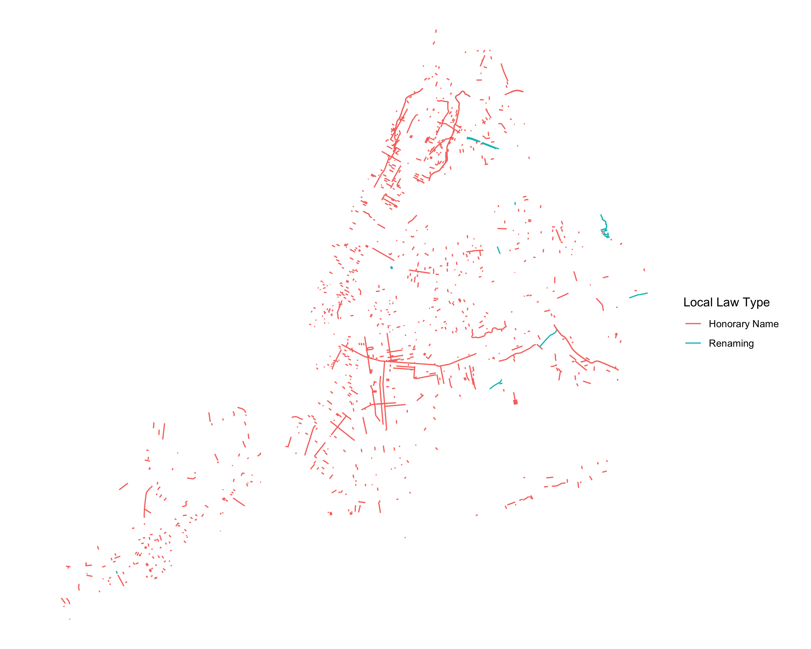
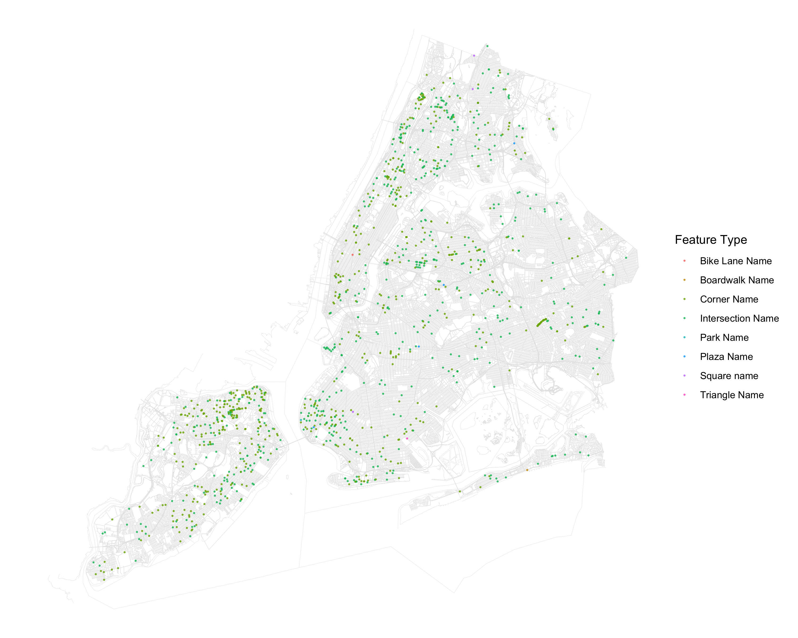

<!-- README.md is generated from README.Rmd. Please edit that file -->

# nycdcm 

<!-- badges: start -->

[](https://github.com/kjhealy/nycdcm/actions/workflows/R-CMD-check.yaml)
<!-- badges: end -->

Provides sf objects from the New York City Digital City Map (DCM) for
drawing street maps and working with NYC street data.

## Installation

You can install the development version of nycdcm like so:

``` r
remotes::install_github("kjhealy/nycdcm")
```

## Load

``` r
library(tidyverse)
#> ── Attaching core tidyverse packages ──────────────────────── tidyverse 2.0.0 ──
#> ✔ dplyr     1.2.0     ✔ readr     2.2.0
#> ✔ forcats   1.0.1     ✔ stringr   1.6.0
#> ✔ ggplot2   4.0.2     ✔ tibble    3.3.1
#> ✔ lubridate 1.9.5     ✔ tidyr     1.3.2
#> ✔ purrr     1.2.1     
#> ── Conflicts ────────────────────────────────────────── tidyverse_conflicts() ──
#> ✖ dplyr::filter() masks stats::filter()
#> ✖ dplyr::lag()    masks stats::lag()
#> ℹ Use the conflicted package (<http://conflicted.r-lib.org/>) to force all conflicts to become errors
library(sf)
#> Linking to GEOS 3.13.0, GDAL 3.8.5, PROJ 9.5.1; sf_use_s2() is TRUE
library(nycdcm)
```

# What’s included

## NYC Digital City Map Street Layer

The main DCM layer containing street data for all of New York City.

``` r
nyc_dcm_sf
#> Simple feature collection with 67979 features and 5 fields
#> Geometry type: MULTILINESTRING
#> Dimension:     XY
#> Bounding box:  xmin: 902501.3 ymin: 113279.3 xmax: 1067481 ymax: 275335.5
#> Projected CRS: NAD83 / New York Long Island (ftUS)
#> First 10 features:
#>      borough      feat_type jurisdicti record_st  edit_date
#> 1  Manhattan Infrastructure       <NA>      <NA> 2023-01-27
#> 2  Manhattan    Unmapped_St       <NA>      <NA> 2021-07-09
#> 3  Manhattan Infrastructure       <NA>      <NA> 2023-01-27
#> 4  Manhattan Infrastructure       <NA>      <NA> 2023-01-27
#> 5  Manhattan Infrastructure       <NA>      <NA> 2023-01-27
#> 6  Manhattan Infrastructure       <NA>      <NA> 2023-01-27
#> 7  Manhattan Infrastructure       <NA>      <NA> 2023-01-27
#> 8  Manhattan Infrastructure       <NA>      <NA> 2023-01-27
#> 9  Manhattan Infrastructure       <NA>      <NA> 2023-01-27
#> 10 Manhattan Infrastructure       <NA>      <NA> 2023-01-27
#>                          geometry
#> 1  MULTILINESTRING ((1006326 2...
#> 2  MULTILINESTRING ((990634.3 ...
#> 3  MULTILINESTRING ((1003395 2...
#> 4  MULTILINESTRING ((985815.6 ...
#> 5  MULTILINESTRING ((1000049 2...
#> 6  MULTILINESTRING ((991519.2 ...
#> 7  MULTILINESTRING ((1003589 2...
#> 8  MULTILINESTRING ((1005369 2...
#> 9  MULTILINESTRING ((1006040 2...
#> 10 MULTILINESTRING ((993156.5 ...
```

``` r
ggplot(nyc_dcm_sf) +
  geom_sf(linewidth = 0.1) +
  theme_void()
```


## NYC Digital City Map Arterials and Major Streets

Major streets and arterials layer from the DCM.

``` r
nyc_dcm_arterial_sf
#> Simple feature collection with 740 features and 6 fields
#> Geometry type: MULTILINESTRING
#> Dimension:     XY
#> Bounding box:  xmin: 913281.5 ymin: 120286.1 xmax: 1067383 ymax: 271908.9
#> Projected CRS: NAD83 / New York Long Island (ftUS)
#> First 10 features:
#>      borough boro_code       route_name    route_type
#> 1  Manhattan         1         2 Avenue Major Streets
#> 2  Manhattan         1        10 Avenue Major Streets
#> 3  Manhattan         1 Amsterdam Avenue Major Streets
#> 4  Manhattan         1    Church Street Major Streets
#> 5  Manhattan         1   Dyckman Street Major Streets
#> 6  Manhattan         1   East 34 Street Major Streets
#> 7  Manhattan         1   East 42 Street Major Streets
#> 8  Manhattan         1   East 57 Street Major Streets
#> 9  Manhattan         1   East 72 Street Major Streets
#> 10 Manhattan         1   East 79 Street Major Streets
#>                      route_sub route_stat                       geometry
#> 1  Major street to be improved   Existing MULTILINESTRING ((986738 20...
#> 2                 Major Street   Existing MULTILINESTRING ((981445.2 ...
#> 3                 Major Street   Existing MULTILINESTRING ((987680.5 ...
#> 4                 Major Street   Existing MULTILINESTRING ((981013.6 ...
#> 5                 Major Street   Existing MULTILINESTRING ((1005561 2...
#> 6                 Major Street   Existing MULTILINESTRING ((988527.9 ...
#> 7                 Major Street   Existing MULTILINESTRING ((989545.4 ...
#> 8                 Major Street   Existing MULTILINESTRING ((991461.4 ...
#> 9                 Major Street   Existing MULTILINESTRING ((993379.4 ...
#> 10                Major Street   Existing MULTILINESTRING ((994296.5 ...
```

``` r
ggplot(nyc_dcm_arterial_sf) +
  geom_sf() +
  theme_void()
```



## Combined View

``` r
ggplot() +
  geom_sf(data = nyc_dcm_sf, color = "gray80", linewidth = 0.1) +
  geom_sf(data = nyc_dcm_arterial_sf, color = "red", linewidth = 0.5) +
  theme_void()
```



## NYC Digital City Map City Map Alterations

City map alterations documenting changes approved by the City Planning
Commission.

``` r
nyc_dcm_alteration_sf
#> Simple feature collection with 5105 features and 19 fields
#> Geometry type: MULTIPOLYGON
#> Dimension:     XY
#> Bounding box:  xmin: 912656.8 ymin: 120319.5 xmax: 1067272 ymax: 272307.9
#> Projected CRS: NAD83 / New York Long Island (ftUS)
#> First 10 features:
#>    boro_code app_num project_nm filed_stat status  effect_dt bp_num cc_res_num
#> 1          Q    5622       <NA>          1     14 1949-09-08   <NA>          0
#> 2          X    9692       <NA>          1     14 1953-05-15  11372          0
#> 3          X   10007       <NA>          1     14 1953-10-17  11387          0
#> 4          X   10059       <NA>          1     14 1954-04-20  11392          0
#> 5          Q   10068       <NA>          1     14 1954-10-20   3679          0
#> 6          Q   10112       <NA>          1     14 1953-11-20   3688          0
#> 7          K   10150       <NA>          1     14 1953-12-19  A-779          0
#> 8          K    1016       <NA>          1     14 1939-12-30  L-917          0
#> 9          Q   10161       <NA>          1     14 1955-11-03   3655          0
#> 10         K   10313       <NA>          1     14 1954-02-18  E-803          0
#>    zr_update  cert_date    chg_type   altmappdf
#> 1          0 -001-11-30     Unknown  cp5622.pdf
#> 2          0 -001-11-30     Unknown  cp9692.pdf
#> 3          0 -001-11-30     Unknown cp10007.pdf
#> 4          0 -001-11-30     Unknown cp10059.pdf
#> 5          0 -001-11-30 Street Line cp10068.pdf
#> 6          0 -001-11-30     Unknown cp10112.pdf
#> 7          0 -001-11-30     Unknown cp10150.pdf
#> 8          0 -001-11-30     Unknown  cp1016.pdf
#> 9          0 -001-11-30     Unknown cp10161.pdf
#> 10         0 -001-11-30    Easement cp10313.pdf
#>                                                                   altmap_link
#> 1   https://nycdcp-dcm-alteration-maps.nyc3.digitaloceanspaces.com/cp5622.pdf
#> 2   https://nycdcp-dcm-alteration-maps.nyc3.digitaloceanspaces.com/cp9692.pdf
#> 3  https://nycdcp-dcm-alteration-maps.nyc3.digitaloceanspaces.com/cp10007.pdf
#> 4  https://nycdcp-dcm-alteration-maps.nyc3.digitaloceanspaces.com/cp10059.pdf
#> 5  https://nycdcp-dcm-alteration-maps.nyc3.digitaloceanspaces.com/cp10068.pdf
#> 6  https://nycdcp-dcm-alteration-maps.nyc3.digitaloceanspaces.com/cp10112.pdf
#> 7  https://nycdcp-dcm-alteration-maps.nyc3.digitaloceanspaces.com/cp10150.pdf
#> 8   https://nycdcp-dcm-alteration-maps.nyc3.digitaloceanspaces.com/cp1016.pdf
#> 9  https://nycdcp-dcm-alteration-maps.nyc3.digitaloceanspaces.com/cp10161.pdf
#> 10 https://nycdcp-dcm-alteration-maps.nyc3.digitaloceanspaces.com/cp10313.pdf
#>    scanned track_num                            source map_series map_cabine
#> 1      Yes      5622 Consultant CAD data, convex hulls  1937-1958       12B1
#> 2      Yes      9692 Consultant CAD data, convex hulls  1937-1958       18C2
#> 3      Yes     10007 Consultant CAD data, convex hulls  1937-1958       19B1
#> 4      Yes     10059 Consultant CAD data, convex hulls  1937-1958       19C1
#> 5      Yes C.P.10068 Consultant CAD data, convex hulls  1924-1937       <NA>
#> 6      Yes     10112 Consultant CAD data, convex hulls  1937-1958       19A2
#> 7      Yes     10150 Consultant CAD data, convex hulls  1937-1958       19B2
#> 8      Yes      1016 Consultant CAD data, convex hulls  1937-1958       03C1
#> 9      Yes     10161 Consultant CAD data, convex hulls  1937-1958       19B2
#> 10     Yes     10313 Consultant CAD data, convex hulls  1937-1958       19A3
#>    map_copies                       geometry
#> 1           1 MULTIPOLYGON (((1053145 184...
#> 2           1 MULTIPOLYGON (((1010925 260...
#> 3           1 MULTIPOLYGON (((1009246 253...
#> 4           1 MULTIPOLYGON (((1010007 242...
#> 5           1 MULTIPOLYGON (((1059501 218...
#> 6           2 MULTIPOLYGON (((1009310 203...
#> 7           1 MULTIPOLYGON (((1002819 194...
#> 8           1 MULTIPOLYGON (((1023365 178...
#> 9           1 MULTIPOLYGON (((1020635 211...
#> 10          1 MULTIPOLYGON (((994740.7 16...
```

``` r
ggplot(nyc_dcm_alteration_sf) +
  geom_sf(aes(fill = boro_code), alpha = 0.5) +
  theme_void() +
  labs(fill = "Borough")
```



## NYC Digital City Map Street Name Changes: Areas

Area-based street name changes including plaza names and public place
names.

``` r
nyc_dcm_snc_area_sf
#> Simple feature collection with 49 features and 13 fields
#> Geometry type: POLYGON
#> Dimension:     XY
#> Bounding box:  xmin: 943560.7 ymin: 141120 xmax: 1061088 ymax: 259094.1
#> Projected CRS: NAD83 / New York Long Island (ftUS)
#> First 10 features:
#>      borough         feat_type ll_num ll_sec        ll_type ll_effect_dt
#> 1  Manhattan      Public place   <NA>      0       Renaming   10/01/2016
#> 2   Brooklyn        Plaza Name    050      4 Initial Naming    07/1/2013
#> 3   Brooklyn Intersection name    014     31 Initial Naming   03/07/2012
#> 4   Brooklyn        Plaza name    075      1 Initial Naming   12/13/1999
#> 5  Manhattan         Park name    065      1       Renaming   12/10/2001
#> 6     Queens   Playground name    052      1       Renaming   11/10/1998
#> 7  Manhattan       Street name    017      1       Renaming   05/18/1999
#> 8     Queens   Playground name    025      1       Renaming   06/28/1999
#> 9   Brooklyn    Ballfield name    033      1       Renaming   07/09/1999
#> 10  Brooklyn         Park name    027      1       Renaming   06/28/1999
#>                                                                                                                                                                            ll_limits
#> 1                                                                                                                                                                               <NA>
#> 2  The plaza bounded by the southwest corner of 4th Avenue and 95th Street, the east side of 4th Avenue opposite 96th Street, and the northeast corner of 4th Avenue and 97th Street
#> 3                                                                    The Lewis Avenue Triangle at Fulton Street and the Green Street space located at Fulton Street and Lewis Avenue
#> 4  the plaza bounded by the southwest corner of 4th Avenue and 95th Street, the east side of 4th Avenue opposite 96th Street, and the northeast corner of 4th Avenue and 97th Street
#> 5                                                                    existing park between Franklin D. Roosevelt Drive and the East River from Montgomery Street to East 12th Street
#> 6                                                                                     a triangle bounded by Hempstead Avenue, 224th Street and the Cross Island Parkway service road
#> 7                                                                                                                   between Oliver Street and Catherine Street within Chatham Square
#> 8                                                                                      Existing playground within George F. Torsney Park, located at Skillman Avenue and 43rd Street
#> 9                                                                                    existing limits of Bay Eighth Street Ballfields located at Bay Eighth Street and Cropsey Avenue
#> 10                                                                                                                                   the park located at 16th Avenue and 70th street
#>    limits_er repealed repeal_dt amended amend_dt amendt_txt
#> 1       <NA>       No      <NA>      No     <NA>       <NA>
#> 2       <NA>       No      <NA>      No     <NA>       <NA>
#> 3       <NA>       No      <NA>      No     <NA>       <NA>
#> 4       <NA>       No      <NA>      No     <NA>       <NA>
#> 5       <NA>       No      <NA>      No     <NA>       <NA>
#> 6       <NA>       No      <NA>      No     <NA>       <NA>
#> 7       <NA>       No      <NA>      No     <NA>       <NA>
#> 8       <NA>       No      <NA>      No     <NA>       <NA>
#> 9       <NA>       No      <NA>      No     <NA>       <NA>
#> 10      <NA>       No      <NA>      No     <NA>       <NA>
#>                          geometry
#> 1  POLYGON ((990240.4 213459.2...
#> 2  POLYGON ((1015715 181857.6,...
#> 3  POLYGON ((1002389 186912.6,...
#> 4  POLYGON ((975428.2 163269.8...
#> 5  POLYGON ((988504.1 198118.3...
#> 6  POLYGON ((1059585 198509.6,...
#> 7  POLYGON ((984724.3 199223.5...
#> 8  POLYGON ((1005948 211469.4,...
#> 9  POLYGON ((979590.3 159976.6...
#> 10 POLYGON ((984798.6 164851.4...
```

``` r
ggplot(nyc_dcm_snc_area_sf) +
  geom_sf(aes(fill = feat_type), alpha = 0.7) +
  theme_void() +
  labs(fill = "Feature Type")
```


## NYC Digital City Map Street Name Changes: Lines

Linear street name changes including street renamings and honorary
street names.

``` r
nyc_dcm_snc_line_sf
#> Simple feature collection with 1145 features and 13 fields
#> Geometry type: MULTILINESTRING
#> Dimension:     XY
#> Bounding box:  xmin: 915919.8 ymin: 121410.5 xmax: 1065275 ymax: 271640.8
#> Projected CRS: NAD83 / New York Long Island (ftUS)
#> First 10 features:
#>    borough   feat_type ll_num ll_sec       ll_type ll_effect_dt
#> 1    Bronx Street name    018      2 Honorary Name    4/11/2011
#> 2   Queens Street name    052      1      Renaming    11/3/2008
#> 3   Queens Street name    052      2      Renaming    11/3/2008
#> 4   Queens Street name    052      3      Renaming    11/3/2008
#> 5   Queens Street name    052      4      Renaming    11/3/2008
#> 6   Queens Street name    052      5      Renaming    11/3/2008
#> 7   Queens Street name    052      6      Renaming    11/3/2008
#> 8   Queens Street name    017      2      Renaming    3/26/2012
#> 9   Queens Street name    017      3      Renaming    3/26/2012
#> 10  Queens Street name    017      4      Renaming    3/26/2012
#>                                                                                                                           ll_limits
#> 1                                                                                              From Fordham Road to Allerton Avenue
#> 2                                                                                       Between Douglaston Parkway and Douglas Road
#> 3                                                                                            Between Hillside Avenue and West Drive
#> 4                                                                                             Between Circle Road and Cherry Street
#> 5                                                                                   Between Douglaston Parkway and Little Neck Road
#> 6                                                                                        Between Douglaston Parkway and Circle Road
#> 7  Between the intersection of Center Drive and Point Crescent to the intersection of Point Crescent (pka 141 Street) and Boulevard
#> 8                                                             Between Pine Street (pka 43 Avenue) and Church Street (pka 44 Avenue)
#> 9                                                            Between Church Street (pka 44 Avenue) and the dead end at Depew Avenue
#> 10                                                                                        Between Douglaston Parkway and 244 Street
#>                                                                           limits_er
#> 1                                                                              <NA>
#> 2                                                                              <NA>
#> 3                                                                              <NA>
#> 4                                                                              <NA>
#> 5                                                                              <NA>
#> 6  Eastern limit should be 240 Street (240 St changed to Circle Rd one block north)
#> 7                                                                              <NA>
#> 8                                                                              <NA>
#> 9                                                                              <NA>
#> 10                                                                             <NA>
#>    repealed repeal_dt amended amend_dt amendt_txt
#> 1       Yes 7/11/2011      No     <NA>       <NA>
#> 2        No      <NA>      No     <NA>       <NA>
#> 3        No      <NA>      No     <NA>       <NA>
#> 4        No      <NA>      No     <NA>       <NA>
#> 5        No      <NA>      No     <NA>       <NA>
#> 6        No      <NA>      No     <NA>       <NA>
#> 7        No      <NA>      No     <NA>       <NA>
#> 8        No      <NA>      No     <NA>       <NA>
#> 9        No      <NA>      No     <NA>       <NA>
#> 10       No      <NA>      No     <NA>       <NA>
#>                          geometry
#> 1  MULTILINESTRING ((1020093 2...
#> 2  MULTILINESTRING ((1053318 2...
#> 3  MULTILINESTRING ((1053251 2...
#> 4  MULTILINESTRING ((1054329 2...
#> 5  MULTILINESTRING ((1054774 2...
#> 6  MULTILINESTRING ((1054271 2...
#> 7  MULTILINESTRING ((1031523 2...
#> 8  MULTILINESTRING ((1054948 2...
#> 9  MULTILINESTRING ((1055271 2...
#> 10 MULTILINESTRING ((1054718 2...
```

``` r
ggplot(nyc_dcm_snc_line_sf) +
  geom_sf(aes(color = ll_type), linewidth = 0.5) +
  theme_void() +
  labs(color = "Local Law Type")
```



## NYC Digital City Map Street Name Changes: Points

Point-based street name changes including intersection names and corner
names.

``` r
nyc_dcm_snc_point_sf
#> Simple feature collection with 1214 features and 13 fields
#> Geometry type: POINT
#> Dimension:     XY
#> Bounding box:  xmin: 915136.6 ymin: 121442.2 xmax: 1063840 ymax: 270551.4
#> Projected CRS: NAD83 / New York Long Island (ftUS)
#> First 10 features:
#>          borough         feat_type ll_num ll_sec        ll_type ll_effect_dt
#> 1  Staten Island Intersection Name    063     70 Initial Naming   12/21/2004
#> 2       Brooklyn Intersection Name    063     10 Initial Naming   12/21/2004
#> 3      Manhattan Intersection Name    063     36 Initial Naming   12/21/2004
#> 4       Brooklyn       Corner Name    063     64 Initial Naming   12/21/2004
#> 5       Brooklyn       Corner Name    063     14 Initial Naming   12/21/2004
#> 6  Staten Island Intersection Name    063     66 Initial Naming   12/21/2004
#> 7       Brooklyn Intersection Name    063     11 Initial Naming   12/21/2004
#> 8  Staten Island       Corner Name    063     53 Initial Naming   12/21/2004
#> 9       Brooklyn       Corner Name    063     77 Initial Naming   12/21/2004
#> 10      Brooklyn       Corner Name    063      8 Initial Naming   12/21/2004
#>                                                                            ll_limits
#> 1                                the intersection of Liberty Avenue and Mason Avenue
#> 2                                    the intersection of 16th Avenue and Bath Avenue
#> 3                           the intersection of West 62nd Street and Columbus Avenue
#> 4                                  the intersection of Avenue T and East 14th Street
#> 5            the northeast corner of the intersection of 72nd Street and 11th Avenue
#> 6                           the intersection of Willowbrook Road and Buchanan Avenue
#> 7                                  the intersection of Senator Street and 3rd Avenue
#> 8  the northwest corner of the intersection of Tomplins Avenue and St. Mary’s Avenue
#> 9           the northeast corner of the intersection of Avenue U and West 9th Street
#> 10                                 the intersection of Gerritsen Avenue and Avenue R
#>    limits_er repealed repeal_dt amended amend_dt amendt_txt
#> 1       <NA>       No      <NA>      No     <NA>       <NA>
#> 2       <NA>       No      <NA>      No     <NA>       <NA>
#> 3       <NA>       No      <NA>      No     <NA>       <NA>
#> 4       <NA>       No      <NA>      No     <NA>       <NA>
#> 5       <NA>       No      <NA>      No     <NA>       <NA>
#> 6       <NA>       No      <NA>      No     <NA>       <NA>
#> 7       <NA>       No      <NA>      No     <NA>       <NA>
#> 8       <NA>       No      <NA>      No     <NA>       <NA>
#> 9       <NA>       No      <NA>      No     <NA>       <NA>
#> 10      <NA>       No      <NA>      No     <NA>       <NA>
#>                     geometry
#> 1  POINT (959495.4 152107.9)
#> 2    POINT (981244.7 160314)
#> 3  POINT (988829.3 220222.8)
#> 4  POINT (995980.4 158234.6)
#> 5  POINT (981509.1 166863.9)
#> 6  POINT (947198.5 159205.6)
#> 7  POINT (977180.5 171404.7)
#> 8  POINT (964108.9 163015.8)
#> 9  POINT (989727.5 156528.2)
#> 10  POINT (1000480 160640.4)
```

``` r
ggplot() +
  geom_sf(data = nyc_dcm_sf, color = "gray90", linewidth = 0.1) +
  geom_sf(data = nyc_dcm_snc_point_sf, aes(color = feat_type), size = 0.25, alpha = 0.7) +
  theme_void() +
  labs(color = "Feature Type")
```


