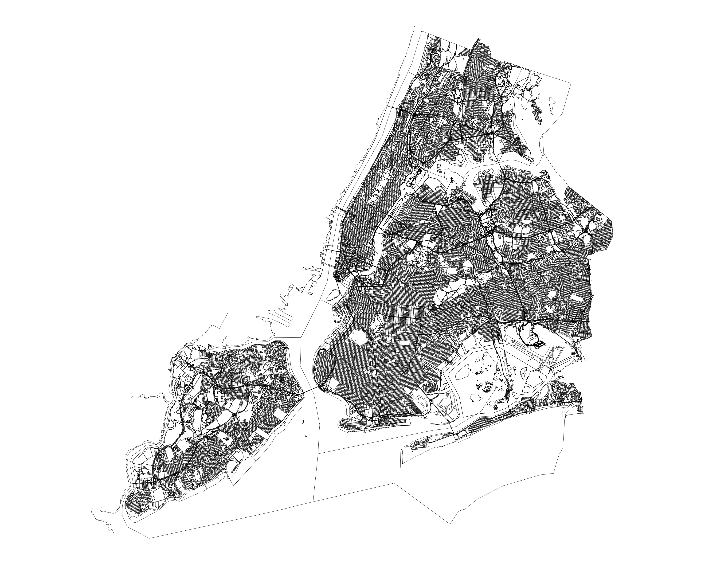

<!-- README.md is generated from README.Rmd. Please edit that file -->

# nycdcm

<!-- badges: start -->

<!-- badges: end -->

Provides sf objects from the New York City Digital City Map (DCM) for
drawing street maps and working with NYC street data.

## Installation

You can install the development version of nycdcm like so:

``` r
remotes::install_github("kjhealy/nycdcm")
```

## Load

``` r
library(tidyverse)
#> ── Attaching core tidyverse packages ───────────────────────────────────────────────────────────────────────────────────────────────── tidyverse 2.0.0 ──
#> ✔ dplyr     1.1.4     ✔ readr     2.1.6
#> ✔ forcats   1.0.1     ✔ stringr   1.6.0
#> ✔ ggplot2   4.0.1     ✔ tibble    3.3.0
#> ✔ lubridate 1.9.4     ✔ tidyr     1.3.1
#> ✔ purrr     1.2.0     
#> ── Conflicts ─────────────────────────────────────────────────────────────────────────────────────────────────────────────────── tidyverse_conflicts() ──
#> ✖ dplyr::filter() masks stats::filter()
#> ✖ dplyr::lag()    masks stats::lag()
#> ℹ Use the conflicted package (<http://conflicted.r-lib.org/>) to force all conflicts to become errors
library(sf)
#> Linking to GEOS 3.13.0, GDAL 3.8.5, PROJ 9.5.1; sf_use_s2() is TRUE
library(nycdcm)
```

# What’s included

## NYC Digital City Map Main Layer

The main DCM layer containing street data for all of New York City.

``` r
nyc_dcm_sf
#> Simple feature collection with 67979 features and 5 fields
#> Geometry type: MULTILINESTRING
#> Dimension:     XY
#> Bounding box:  xmin: 902501.3 ymin: 113279.3 xmax: 1067481 ymax: 275335.5
#> Projected CRS: NAD83 / New York Long Island (ftUS)
#> First 10 features:
#>      borough      feat_type jurisdicti record_st  edit_date
#> 1  Manhattan Infrastructure       <NA>      <NA> 2023-01-27
#> 2  Manhattan    Unmapped_St       <NA>      <NA> 2021-07-09
#> 3  Manhattan Infrastructure       <NA>      <NA> 2023-01-27
#> 4  Manhattan Infrastructure       <NA>      <NA> 2023-01-27
#> 5  Manhattan Infrastructure       <NA>      <NA> 2023-01-27
#> 6  Manhattan Infrastructure       <NA>      <NA> 2023-01-27
#> 7  Manhattan Infrastructure       <NA>      <NA> 2023-01-27
#> 8  Manhattan Infrastructure       <NA>      <NA> 2023-01-27
#> 9  Manhattan Infrastructure       <NA>      <NA> 2023-01-27
#> 10 Manhattan Infrastructure       <NA>      <NA> 2023-01-27
#>                          geometry
#> 1  MULTILINESTRING ((1006326 2...
#> 2  MULTILINESTRING ((990634.3 ...
#> 3  MULTILINESTRING ((1003395 2...
#> 4  MULTILINESTRING ((985815.6 ...
#> 5  MULTILINESTRING ((1000049 2...
#> 6  MULTILINESTRING ((991519.2 ...
#> 7  MULTILINESTRING ((1003589 2...
#> 8  MULTILINESTRING ((1005369 2...
#> 9  MULTILINESTRING ((1006040 2...
#> 10 MULTILINESTRING ((993156.5 ...
```

``` r
nyc_dcm_sf |>
    filter(!feat_type %in% c("Boro_line", "Bulkhead_line", "Rail")) |>
    ggplot() +
    geom_sf(linewidth = 0.1) +
    theme_void()
```



## NYC Digital City Map Arterials and Major Streets

Major streets and arterials layer from the DCM.

``` r
nyc_dcmarterial_sf
#> Simple feature collection with 740 features and 6 fields
#> Geometry type: MULTILINESTRING
#> Dimension:     XY
#> Bounding box:  xmin: 913281.5 ymin: 120286.1 xmax: 1067383 ymax: 271908.9
#> Projected CRS: NAD83 / New York Long Island (ftUS)
#> First 10 features:
#>      borough boro_code       route_name    route_type
#> 1  Manhattan         1         2 Avenue Major Streets
#> 2  Manhattan         1        10 Avenue Major Streets
#> 3  Manhattan         1 Amsterdam Avenue Major Streets
#> 4  Manhattan         1    Church Street Major Streets
#> 5  Manhattan         1   Dyckman Street Major Streets
#> 6  Manhattan         1   East 34 Street Major Streets
#> 7  Manhattan         1   East 42 Street Major Streets
#> 8  Manhattan         1   East 57 Street Major Streets
#> 9  Manhattan         1   East 72 Street Major Streets
#> 10 Manhattan         1   East 79 Street Major Streets
#>                      route_sub route_stat                       geometry
#> 1  Major street to be improved   Existing MULTILINESTRING ((986738 20...
#> 2                 Major Street   Existing MULTILINESTRING ((981445.2 ...
#> 3                 Major Street   Existing MULTILINESTRING ((987680.5 ...
#> 4                 Major Street   Existing MULTILINESTRING ((981013.6 ...
#> 5                 Major Street   Existing MULTILINESTRING ((1005561 2...
#> 6                 Major Street   Existing MULTILINESTRING ((988527.9 ...
#> 7                 Major Street   Existing MULTILINESTRING ((989545.4 ...
#> 8                 Major Street   Existing MULTILINESTRING ((991461.4 ...
#> 9                 Major Street   Existing MULTILINESTRING ((993379.4 ...
#> 10                Major Street   Existing MULTILINESTRING ((994296.5 ...
```

``` r
ggplot(nyc_dcmarterial_sf) +
  geom_sf(linewidth = 0.2) +
  theme_void()
```


## Combined View

``` r
ggplot() +
  geom_sf(data = nyc_dcm_sf, color = "gray80", linewidth = 0.1) +
  geom_sf(data = nyc_dcmarterial_sf, color = "red", linewidth = 0.5) +
  theme_void()
```


